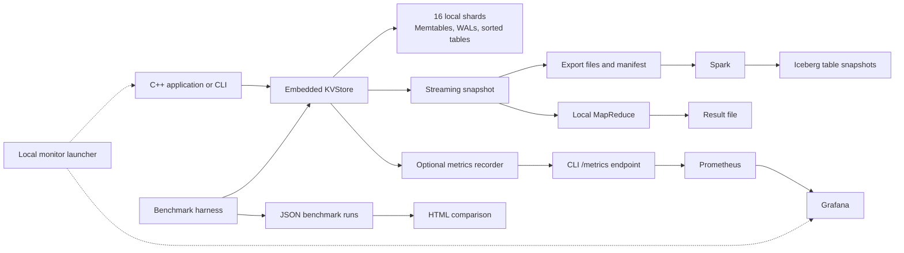

# KVStore architecture

Keep the repository name `kvstore`. Its main job is to store and retrieve values by key. It is **embedded**, which means the C++ library runs inside the application on one machine. Recent writes stay in memory for quick reads, and the engine keeps data on disk so the database can grow beyond the write buffer. A fixed view of the data also feeds local MapReduce jobs and Spark-to-Iceberg analytics.

## System at a glance



Both data-processing paths stream a snapshot, a view of the database at a single point in time. The embedded engine, CLI, and benchmark harness have no runtime dependency on the analytics or monitoring services.

| Component | Entry point | Present behavior |
| --- | --- | --- |
| Storage engine | [kvstore.hpp](../kvstore.hpp), [kvstore.cpp](../kvstore.cpp) | Durable point operations, disk-backed reads, rolling range scans, offline WAL migration |
| Shell and exporter | [cli.cpp](../cli.cpp), [metrics_http.cpp](../metrics_http.cpp) | Interactive commands and an optional Prometheus endpoint |
| Batch computation | [mapreduce.hpp](../mapreduce.hpp), [word_count_main.cpp](../examples/word_count_main.cpp) | Single-worker mapper, disk-backed shuffle, and word count from a database or fixture |
| Analytical publication | [lakehouse/export.py](../lakehouse/export.py), [lakehouse/publish.py](../lakehouse/publish.py) | Verified database snapshots published to a local Spark/Iceberg table |
| Performance measurement | [bench.cpp](../bench.cpp), [benchmarks/compare.py](../benchmarks/compare.py) | Repeatable workload trials, latency distributions, JSON, and baseline comparison |
| Observability | [monitor](../monitor), [metrics.cpp](../metrics.cpp) | Browser-based status and app launcher, plus Prometheus metrics, Grafana panels, and alerts |

## Embedded storage engine

Each key identifies one value, with an optional expiration time. The C++ API accepts arbitrary bytes, so the application decides whether a value contains text, a structured record, or other data. Keys can be up to 1 MiB and values up to 256 MiB. The command-line interface accepts text commands.

Each **shard** is a group of keys stored in its own directory. For new databases, **rendezvous consistent hashing** gives each of the 16 shards a repeatable score for a key and picks the highest score. In a routing test, adding a candidate moves only keys that pick it as their new winner. Removing a candidate moves only keys it used to own. The running database keeps all 16 shards fixed. Its `METADATA` file records the format, routing, shard count, and write buffer size. [Routing implementation](../routing.hpp)

Each shard has three main parts.

- A **memtable** holds recent writes in an ordered in-memory buffer.
- A **write-ahead log (WAL)** records changes on disk so the engine can replay them after a crash.
- **Sorted tables (SSTables)** hold data flushed to disk. Keys are stored in order, and the files stay fixed once written. The shard's `MANIFEST` lists which files recovery should use.

A lock file permits one open instance per database. Opening through a symbolic link uses the same lock.

### Write and read paths

1. **Make room.** The default write buffer is 16 MiB, split across 16 shards. If a write would overfill its shard's buffer, the engine first writes that buffer to a sorted disk file. A single oversized write can still take the normal write path and flush during the call.
2. **Save the changes.** The engine appends an ordered record for each change to the WAL. Each record has a checksum, a value used to detect corruption. `Set()` requests one WAL sync per call. `SetBatch()` usually appends several records with one system call and one sync. A sync asks the operating system to make the log durable. The engine updates the buffer and reports success after the sync succeeds. If the append or sync fails, it tries to roll the WAL back to its prior size.
3. **Group batch writes by shard.** Use `ShardForKey()` first. A multi-entry batch must fit within that shard's share of the write buffer. A batch that spans shards or exceeds the limit returns `false` before logging any updates. If a key appears more than once, its last update wins.
4. **Read the newest copy.** A single-key lookup checks the write buffer first, then the disk tables from newest to oldest. The disk lookup uses each table's key range and an index that records where blocks start. A delete marker or expired entry hides older values. The engine checks the on-disk records it uses to decide whether to return the value.

A global lock makes writes and flushes take turns. A write also holds its shard's lock so readers see a completed update or batch. Other shards can keep serving single-key reads. Disk lookups and scans share another lock, and the operating system can serve repeated disk reads from its cache.

`Size()` counts rows without loading every value. `Range()` and `Items()` gather and sort their results in memory. They visit shards in turn, so a scan can reflect writes from different moments. Use a snapshot when the entire scan must reflect one moment.

### Flush and restart

A **flush** turns a shard's write buffer into a sorted file. The engine syncs the new table and creates the next WAL, then saves those directory changes. It switches the manifest to the new files and syncs the directory again before removing the old WAL. If that last sync fails, the engine requires a reopen to learn which file set survived. An unacknowledged write can survive such a failure.

On restart, the engine checks the active files and replays the WAL to rebuild recent writes. It can discard an incomplete final record or a final record with a bad checksum. Each batch uses the same record format as a single write, so an interrupted batch can leave some of its records on disk and recover partially. A bad final checksum can also discard an acknowledged record damaged after the sync. Length fields and block offsets have no separate checksums, so some corruption after startup can make a lookup miss a record or make recovery misread a record boundary. Crash durability depends on the filesystem and device honoring syncs.

### Compaction and snapshots

**Compaction** merges sorted files so reads have fewer files to check. When a shard has eight sorted files, its next write attempts a merge. The merge happens during the write and can delay other writes and reads on that shard. A recoverable merge failure leaves the current files in use. The next attempt follows another flush. `Compact()` also flushes and merges on demand. Both paths keep the newest value and can drop deleted or expired entries when every older copy is covered. The engine syncs the merged file and switches the manifest before removing the files it replaced.

`OpenSnapshot()` streams rows one at a time so the entire result need not fit in memory. It holds the writer lock to keep all 16 shards and their expiration cutoff fixed at the capture time. Single-key reads can continue. Writes wait until streaming finishes or the snapshot is closed. Open, consume, and close it on the same thread.

### Shard isolation, restore, and failover

In the default strict mode, a shard failure can stop the whole database. In **degraded mode**, the engine takes the damaged shard out of service. The healthy shards can still read and write individual keys. Requests to read a damaged shard report an error. Whole-database scans, counts, and snapshots require every shard.

A **checkpoint** is a verified copy of the database at one point in time. It can be made through the C++ API while writes wait, or from the CLI after other processes close the database. To restore one shard, the engine verifies a replacement from a checkpoint of the same database and switches that shard to the replacement in one rename. Other shards keep their current data. The old shard files stay available for diagnosis. For databases using legacy routing, restore records the new format before switching the shard so an older binary refuses to open stale files.

After host loss, an operator can bring up the latest checkpoint on another host and redirect the application once the original host can no longer accept writes. Recovery reaches the point captured by that checkpoint.

## Local MapReduce

One local worker runs three steps against a live snapshot or sample files.

1. **Map.** Read one input row at a time and emit intermediate key-value pairs. In word count, the mapper emits `(word, 1)` for each word.
2. **Shuffle.** Group pairs by the key the mapper produced. The worker sorts batches in memory and writes them to temporary files when the buffer fills. It merges a limited number of files at a time.
3. **Reduce.** Read one group at a time and combine its values. Word count adds the ones to get a total for each word.

The job's groups depend on the keys emitted by the mapper, so matching words end up together regardless of where their input rows were stored. A large group can stream from disk. Each open file reader still holds one record in memory, and callbacks manage their own memory. The temporary disk budget covers intermediate files and the staged result. The worker syncs the result before using a rename to replace the destination. [MapReduce API](../mapreduce.hpp)

## Spark and Iceberg publication

KVStore handles individual key lookups. The lakehouse pipeline uses **Spark** to process rows and **Iceberg** to track a table's schema and versions over data files. SQL queries can read any retained version. The table has named columns for keys, values, and timestamps. Keys and values keep their original bytes. A query that needs fields inside a value must decode that value first.

The Python exporter streams the database at one capture time and gives the export a sequence number. It writes chunks of newline-delimited JSON and uses base64 to carry arbitrary bytes as text. Once the stream finishes successfully, it writes a manifest that lists the chunks, row counts, and checksums. The publisher verifies the manifest and chunks before Spark checks that keys are unique and writes a full replacement table as Parquet, a column-oriented file format. Each Iceberg commit records which export it came from. That lets a retry find a completed commit and prevents an older export from replacing a newer table. [Lakehouse runbook](../lakehouse/README.md)

## Benchmarks and monitoring

`kvstore_bench` measures reads, durable writes, mixed traffic, compaction during traffic, and reopen time. Each trial starts with a fresh store and checks the data after reopening. **Throughput** is the number of completed operations per second. Each key written in a batch counts as one operation. Looking up a key that was deliberately left absent also counts as a completed read. **p99 read latency** is the time within which roughly 99 out of 100 reads finished.

The 95% read and 5% write comparison used a Release build, four threads, and 1,000 preloaded keys. For reads that target existing keys, 90% of selections favor four hot keys and the other 10% use the full keyspace. Each worker writes to one of the shards holding those hot keys. Each batch size ran three trials totaling 456,000 reads and 24,000 writes.

| Writes per call | Total ops/s | p99 read latency | p99 write call latency |
| ---: | ---: | ---: | ---: |
| 1 | 4,247 | 6.53 µs | 360.71 ms |
| 100 | 313,943 | 2.56 µs | 14.16 ms |
| 500 | 1,221,288 | 1.92 µs | 12.32 ms |
| 1,000 | 1,907,559 | 1.47 µs | 13.63 ms |

This run used an Intel i9-13900H. The 1,000 preloaded keys fit in memory. Workers collect writes during the read loop and submit them in bursts. Write call latency starts when the batch is submitted and includes time waiting for locks and syncing the WAL. Throughput also includes time spent collecting the batch. The largest batch size produced 24 timed write calls, so its p99 reflects the slowest calls in a small sample.

### Reproduce the read-heavy benchmark

Use a Release build and run the four configurations sequentially. Each uses the same hot keys, read/write ratio, and write-shard assignments.

```bash
mkdir -p build/benchmarks/read-heavy-hot-shards
for size in 1 100 500 1000; do
  ./build/kvstore_bench --workload mixed --distribution hot --read-percent 95 \
    --hot-keys 4 --threads 4 --trials 3 --ops 40000 --batch-size "$size" --mode latency \
    --json "build/benchmarks/read-heavy-hot-shards/batch-$size.json" || break
done
```

The HTML report compares matching workload parameters and checks the host, compiler, build type, shard count, and telemetry settings before showing percentage changes. Benchmark JSON records the revision at configure time. Reconfigure after changing revisions and use matching compiler flags and test conditions.

### Monitoring

Run `./monitor` to start monitoring and open the browser launcher. The CLI can expose a local `/metrics` endpoint with operation counts and timing buckets. It omits keys, values, and database paths from metric labels and avoids taking storage locks. Prometheus collects the measurements and checks four alert conditions. Grafana shows how throughput, latency, errors, and storage activity change over time. Its live charts count each `SetBatch()` call as one request. The benchmark reports each key written as an operation. [Monitoring setup](../README.md#local-monitoring)

## Resume bullets and explanations

**Embedded Key-Value Store (Disk-Backed)** | *C++20, Linux, Spark, Iceberg, Prometheus, Grafana*

### Recommended four

- Measured **1.91M ops/s** at **1.47 µs p99 read latency** on a warm 95/5 workload with 1,000-write batches.

  For every 100 operations, 95 were reads and five were writes. Four workers read mostly from a small set of frequently used keys and wrote in groups of 1,000, with one durable log sync per group. Each read or key update counted as one operation. About 99 out of 100 reads finished within 1.47 microseconds. [Benchmark setup and results](#benchmarks-and-monitoring)

- Stored **12 MiB with a 1 MiB write buffer** by flushing updates to sorted files across **16 shards**.

  A local capacity check inserted 768 values of 16 KiB each. As the buffer filled, the engine moved data to disk. After updating and deleting some keys, the check reopened the store and verified single-key reads and a range scan. The 1 MiB figure is the configured limit for recent writes. Other parts of the process use memory too. [Write and read paths](#write-and-read-paths)

- Kept **15 of 16 shards** readable by isolating a failed shard, then restored it from backup.

  A shard holds part of the database. The test made one shard's data file unavailable and read a known key from each of the 15 healthy shards. It then restored the damaged shard from a verified backup and checked the restored value after reopening. [Shard recovery tests](../tests/failure_tests.cpp)

- Enabled SQL queries on **2 Iceberg table versions** by publishing database snapshots with Spark.

  The test exported the live database, changed and deleted keys, then exported it again. Spark published both exports into an Iceberg table. A query against the newest version saw the changes, and a query against the first version still saw the original data. KVStore supplies the snapshot and export pipeline. Spark and Iceberg provide the processing and versioned table. [Live export verification](../lakehouse/verify.py)

### Alternate bullets

- Kept **15 of 16 shards** open to reads during a single-shard write using per-shard read/write locks.

  A write blocks reads on its own shard while it saves changes and updates memory. Readers can still look up keys on other shards. A separate lock makes all writers take turns. [Locking and write path](#write-and-read-paths)

- Made writes durable across **16 shards** by syncing a checksummed log before updating the in-memory buffer.

  The write-ahead log records each change before the engine updates the in-memory buffer. The disk sync makes acknowledged writes recoverable when storage honors the sync, and the checksum helps detect corrupted records during replay. [Flush and restart](#flush-and-restart)

- Reduced **8 sorted files to 1** in a storage test by triggering compaction automatically during writes.

  The test filled one shard with eight sorted files. The next write automatically merged them and left one active sorted file for that shard. The test reopened the database and checked that the latest write was still there. [Compaction tests](../tests/failure_tests.cpp)

- Preserved deletes through **2 simulated compaction crashes** by publishing merged tables before removing old files.

  The test stopped the process before publishing the new file list and just after swapping it in. Reopening in either case kept the deleted key absent and let the store accept a new write. [Crash recovery tests](../tests/failure_tests.cpp)

- Verified consistent hashing across **8,192 keys** by testing which keys moved when a shard was added or removed.

  The test routed the same keys with 15, 16, and 17 candidate shards. Adding a candidate moved keys only to that candidate, and removing a candidate moved only its former keys. The database itself runs with 16 shards. [Routing tests](../tests/failure_tests.cpp)

- Added **4 Prometheus alerts** for elevated errors, low disk space, missing metrics, and quarantined shards.

  Prometheus checks the metrics exposed by the engine. A quarantined shard is one the engine has taken out of service after detecting a failure. Grafana shows the metrics and alert status. [Alert rules](../monitoring/alerts.yml)

## Verification

CTest covers batch append and sync failures, automatic compaction, recovery after interrupted merges and shard restore, isolation of damaged shards, snapshot consistency, routing, MapReduce, and the benchmark harness. Separate integration checks exercise [the Spark/Iceberg publisher](../lakehouse/README.md#run-locally) and [the monitoring stack](../README.md#manual-setup-and-docker-compose).
