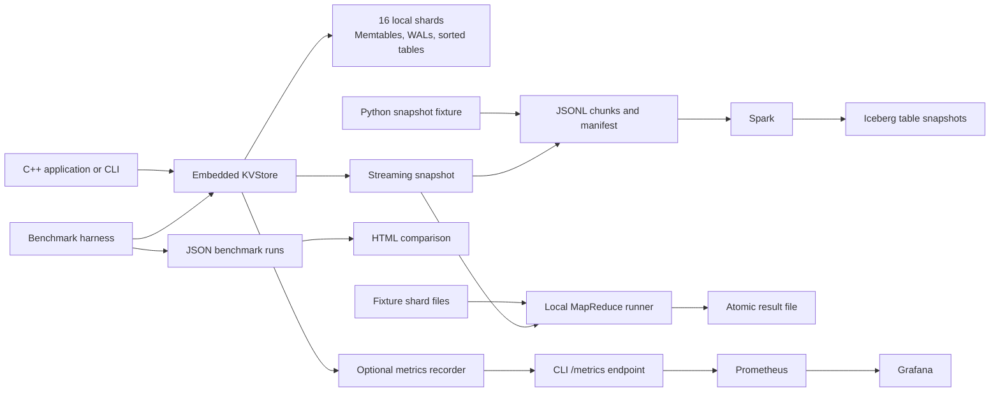

# KVStore architecture and audit

**Keep the name `kvstore`.** The product is an embedded, disk-backed key-value engine. The batch runner, lakehouse publisher, benchmark tools, and monitoring stack are companion components. A more descriptive project subtitle is **Embedded key-value storage with local data processing and observability**. A name such as “lakehouse” or “distributed database” would imply that the project already provides shared analytical tables directly or serves data across hosts.

## System at a glance



Both data-processing paths can stream a live database snapshot. A snapshot shows the data as it existed at one time. The fixtures remain available for testing each tool by itself. The engine, benchmark harness, CLI, and telemetry recorder run without Spark, Iceberg, or Grafana.

| Component | Entry point | Present behavior |
| --- | --- | --- |
| Storage engine | [kvstore.hpp](../kvstore.hpp), [kvstore.cpp](../kvstore.cpp) | Durable point operations, disk-backed reads, rolling range scans, offline WAL migration |
| Shell and exporter | [cli.cpp](../cli.cpp), [metrics_http.cpp](../metrics_http.cpp) | Interactive commands and an optional Prometheus endpoint |
| Batch computation | [mapreduce.hpp](../mapreduce.hpp), [word_count_main.cpp](../examples/word_count_main.cpp) | Single-worker mapper, disk-backed shuffle, and word count from a database or fixture |
| Analytical publication | [lakehouse/export.py](../lakehouse/export.py), [lakehouse/publish.py](../lakehouse/publish.py) | Verified database snapshots published to a local Spark/Iceberg table |
| Performance measurement | [bench.cpp](../bench.cpp), [benchmarks/compare.py](../benchmarks/compare.py) | Repeatable workload trials, latency distributions, JSON, and baseline comparison |
| Observability | [metrics.cpp](../metrics.cpp), [monitoring/compose.yml](../monitoring/compose.yml) | Live Prometheus metrics, a Grafana dashboard, and local alerts |

## Embedded storage engine

The C++20 API maps a binary key to one binary value and optional absolute expiration. Keys can be up to 1 MiB and values up to 256 MiB. Applications define any schema inside those values. Operations are local to the process. The CLI adds a text interface, while the C++ API supports arbitrary bytes.

Each shard is a group of keys stored in its own directory. New databases use **rendezvous consistent hashing**. The engine hashes the key bytes, computes a score for each of the 16 shard IDs, and picks the highest score. If a future system adds a shard, a key moves only when the new shard beats its current owner. If a shard is removed, only keys owned by that shard need to move. KVStore keeps the count fixed at 16 and has no live resharding. [Routing implementation](../routing.hpp)

Checksummed `METADATA` records the format version, routing algorithm, shard count, and in-memory write budget. Older databases retain their FNV-1a modulo routing so existing keys stay where they were written. The offline `--rehash` command can copy their live rows and expiration times into a fresh database using the new routing.

Each shard has a memtable, which is the in-memory write buffer, a write-ahead log (WAL), which records writes for crash recovery, and immutable sorted disk files called SSTables. The checksummed `MANIFEST` tells recovery which files are current. For newest generation `n`, the active WAL is `(n+1).wal`. If there is a merged base table, it replaces all earlier generations. The sibling advisory lock permits one open instance per database. Symlink aliases resolve to the same lock identity.

### Write and read paths

1. A write selects the shard under the global writer mutex and takes the shard's exclusive lock. If the new record would exceed the shard's remaining memory allowance, it flushes the existing buffer first.
2. The engine appends the mutation with the next shard-local sequence, writes the lengths, type, expiry and CRC32, and calls `fdatasync`. It applies the change in memory only after that call succeeds. If an append fails, it attempts a synced rollback to the previous WAL boundary.
3. The default 16 MiB memtable budget is divided across the shards. A record larger than its shard's allowance can be written and flushed synchronously. The budget accounts for retained write data and WAL replay. Total process memory also includes oversized records, results returned to callers, and other allocations.
4. A point read looks in the memtable, then probes SSTables from newest to oldest using key ranges and an on-disk sparse index. The newest delete or expired record masks older versions. Returned values and selected on-disk records that suppress visibility are checksum-verified.
5. Range scans visit shards in turn, resolve visible versions, and sort collected results by key. `Size()` counts without materializing the values. `Items()` and `Range()` return vectors that may grow with the result set. Concurrent writes can produce a rolling view across shards.

Memtable reads use per-shard shared locks. Writes and flushes serialize on the global writer mutex. Disk-backed lookups and scans also share a disk-read mutex, which limits concurrent disk work. The engine relies on the operating system's file cache. There is no engine-managed block cache.

### Flush, restart, and migration

A flush writes and syncs a new SSTable and the next WAL. It syncs their directory entries, publishes the new manifest by rename, and syncs the directory again before retiring the previous WAL. A failure before publication can leave files that the old manifest does not reference. A failure after rename but before the final directory sync leaves an uncertain outcome. The engine then requires a reopen, and a write that was never acknowledged may survive recovery.

Startup validates the metadata, manifests, committed table indexes, record order, and checksums. It replays the active WAL for each shard and can repair an incomplete trailing record. The existing format also truncates a complete final record with a CRC mismatch. This preserves the established torn-tail policy but can discard a previously acknowledged record if the final record was corrupted after its sync. Record lengths and sparse-index entries lack independent checksums, so some post-open corruption can escape a point lookup and a damaged length can obscure a WAL boundary. The crash tests cover process exits and injected errors. Durability during actual power loss depends on the filesystem and device honoring syncs.

The CLI's offline migration streams a legacy CRC-protected WAL into a staged version-1 database. It keeps both process locks, preserves mutation order and absolute TTLs, reopens the staged destination to validate it, and then publishes the directory. The legacy WAL remains available. The format and command are described in the [README](../README.md#offline-migration).

### Compaction and snapshots

`Compact()` first flushes pending writes, then merges multiple sorted files per shard. Compaction keeps the newest version for each key and drops deleted or expired entries when the merge covers all older files. It reads two sorted inputs at a time, syncs the merged output, publishes the new manifest, and only then retires the old files. Automatic flushes still create separate tables until compaction is run. Older binaries cannot read a manifest that selects a merged base.

`OpenSnapshot()` holds the writer lock while streaming rows. That keeps all 16 shards at one point in time and gives every row the same expiration cutoff. It reads from memory and disk a row at a time, so memory does not grow with the number of results. Point reads can continue. Writers wait until the snapshot reaches its end or is destroyed. The same thread must open, consume, and close it.

### Shard isolation, restore, and failover

In strict mode, a shard failure can stop the whole database. Optional degraded mode quarantines the affected shard, taking it out of service. Healthy shards can still serve point requests. Reads on a quarantined shard raise an error, and scans, counts, and snapshots fail rather than returning incomplete results.

A checkpoint is a consistent, validated copy of all the active database files. It can run through the embedded API while writes wait, or from the CLI once other processes have closed the database. To restore a shard, the operator selects a checkpoint with the same database identity and routing. The engine verifies the replacement and switches the shard's current-directory pointer atomically, leaving the earlier files available for diagnosis. Only the selected shard is rolled back.

If the entire host is lost, the operator can bring up a copy of the checkpoint on another host. This is manual failover, meaning a human redirects the application after ensuring the original host cannot still accept writes. Recovery is limited to data in the checkpoint. Continuous replication and automatic failover would need a way for hosts to agree on which one can write.

## Local MapReduce

The runner consumes a caller-supplied `SnapshotCursor` one row at a time. A mapper can emit multiple intermediate pairs. Routing uses the emitted key so matching terms from different source files reach the same reducer group. The shuffle sorts bounded in-memory batches and spills runs to temporary disk. A bounded-fan-in merge creates ordered runs, and a reducer streams values from one group, so a large group need not fit in RAM.

The single worker runs partition by partition. The map buffer has a byte limit. As documented in [mapreduce.hpp](../mapreduce.hpp), merge memory can grow with fan-in because each reader holds a record, and caller callbacks own their allocations. The temporary disk budget includes shuffle runs, intermediate merge output, and the staged result. A successful job syncs the result, renames it over the destination, and syncs the parent directory. Failure before publication preserves the previous result. After rename, a directory sync failure is reported as uncertain publication.

The word-count example accepts immutable tab-delimited fixture files or `--database` for a real KVStore. It lowercases ASCII letters, emits `(word, 1)`, and adds counts with overflow checks. The shuffle groups terms by the key the mapper emits. This job partitioning is separate from the database's rendezvous hashing. The runner uses one local worker.

## Spark and Iceberg publication

The Python producer allocates a monotonically increasing capture sequence under a local coordinator lock and serializes a supplied frozen view. It preserves binary keys and values with base64, evaluates expiration at the capture timestamp, and writes bounded JSONL chunks. After the chunks are synced, it publishes a completion manifest with the export ID, schema version, capture time and sequence, row counts, sizes, and SHA-256 digests.

The publisher validates the manifest and listed chunks into a private input directory. Spark decodes the binary columns, checks row counts and key uniqueness, and writes a full replacement as Parquet through Iceberg. Each Iceberg snapshot records the export identity and sequence. A retry checks snapshot history for a matching commit, and an older capture cannot replace a newer current snapshot. Iceberg retains historical versions according to its snapshot retention settings. The [lakehouse runbook](../lakehouse/README.md) describes the local catalog and verification workflow.

KVStore remains the point-read engine. Iceberg supplies analytical tables with version history. The Python exporter reads a binary stream from the CLI and writes the completion manifest only after the engine reaches the end of the snapshot and exits successfully. An incomplete or unreadable source therefore cannot reach Iceberg publication.

## Benchmarks and monitoring

`kvstore_bench` runs closed-loop reads, durable writes, mixed traffic, a flush co-scheduled with mixed traffic, and reopen trials. It uses seeded uniform and hot-key workloads, isolated directories, a synchronized start, a monotonic clock, and checks final data outside the timed interval. It reports completed ops/s, attempted ops/s, failure rates, and per-operation mean and p50/p95/p99 latency in latency mode. Expected misses count as completed reads. Across valid trials, the reported average divides total completed operations by total measured time. The report also shows the median, range, and sample counts.

The HTML comparison pairs matching workload parameters and suppresses deltas when the host, compiler, build type, shard count, or an unapproved telemetry setting differs. The artifact records revision and dirty state at configure time. Reconfigure after changing the revision, and keep compiler flags and environmental conditions matched separately. The smoke suite checks the harness and the report. It provides no statistically controlled performance comparison, cold-cache benchmark, or measurement of absolute memory usage beyond RAM.

The live recorder keeps counters and bounded latency histograms, which group request times into buckets. The CLI optionally exposes `/metrics` over IPv4, defaulting to loopback. The exporter avoids the engine's storage locks, and metrics labels exclude keys, values, and database paths. Prometheus collects metrics and evaluates alerts. Grafana shows rolling throughput, latency, errors, WAL syncs, table writes, flush activity, disk lookups, and resource use. Alerts cover error rate, low disk space, missing telemetry, and quarantined shards.

## Resume bullets and explanations

Keep the repository name `kvstore`. On the resume, the project header can highlight disk-backed storage.

**Embedded Key-Value Store (Disk-Backed)** | *C++20, Linux, Spark, Iceberg, Prometheus, Grafana*

### Recommended four

- Benchmarked **25.9M read ops/s** at **1.09 µs p99 latency** across 48M in-memory lookups with 16 threads.

  The benchmark ran three trials with 16 threads and 1,000 preloaded keys, choosing keys uniformly. The figures come from the same run with latency sampling enabled. Throughput is completed lookups per second. The p99 is the time within which about 99% of individual lookups completed. [Benchmark harness](../bench.cpp)

- Stored **12 MiB with a 1 MiB write buffer** by flushing writes to sorted disk files across **16 disk-backed shards**.

  The check inserted 768 values of 16 KiB each, then overwrote and deleted some keys. After closing and reopening the store, it verified point and range reads. The 1 MiB budget applied to the write buffer, while total process memory also includes other allocations. [Write and read paths](#write-and-read-paths)

- Kept **15 of 16 shards** readable during a simulated failure by isolating one shard and restoring it from backup.

  The check removed one shard's data file, opened the store in degraded mode, and read one key from each healthy shard. It then restored the affected shard from a checkpoint and verified its value after reopening. A checkpoint is a verified copy of the database at one point in time. [Shard recovery tests](../tests/failure_tests.cpp)

- Enabled historical SQL queries on **2 Iceberg table versions** by streaming consistent snapshots through Spark.

  The integration test published two snapshots from a real KVStore database. It verified that current queries saw the updates and deletes, while a query pinned to the first snapshot still returned the old values. The project implements the export and publication pipeline using Apache Spark and Apache Iceberg. [Live export verification](../lakehouse/verify.py)

### Alternate bullets

- Kept **15 of 16 shards** open to reads during a single-shard write by locking only the affected shard.

  A write holds an exclusive lock on its target shard through the write-ahead log update, memory update, and any flush it triggers. Other shards can still serve point reads. The global writer lock serializes writes, and disk-backed reads also share a disk-read lock. [Locking and write path](#write-and-read-paths)

- Made writes durable across **16 shards** by syncing a checksummed log before updating the in-memory buffer.

  The write-ahead log records each change before the engine updates the in-memory buffer. The disk sync makes acknowledged writes recoverable when storage honors the sync, and the checksum helps detect corrupted records during replay. [Flush and restart](#flush-restart-and-migration)

- Averaged **28.9M read ops/s** across 3 trials by benchmarking 16 concurrent readers on 1,000 preloaded keys.

  This is the uniform read workload in throughput-only mode. Latency sampling was off for this measurement. [Benchmark harness](../bench.cpp)

- Sustained **25.1M read ops/s at 1.95 µs p99** on a 16-thread workload concentrated on frequently accessed keys.

  This is the hot-key workload, where most requests target a small subset of keys. Both figures came from the same latency-enabled benchmark across three trials. [Benchmark harness](../bench.cpp)

- Reduced **3 disk files to 1** in a compaction test by merging sorted files and removing superseded records.

  The test wrote two versions of one key and then deleted it. Compaction merged the three sorted data files into a single table and kept the key deleted after reopening. The count refers to those data files. [Compaction tests](../tests/failure_tests.cpp)

- Preserved deletes through **2 simulated compaction crashes** by publishing merged tables before removing old files.

  The test stopped the process before publishing the new file list and just after swapping it in. Reopening in either case kept the deleted key absent and let the store accept a new write. [Crash recovery tests](../tests/failure_tests.cpp)

- Verified consistent hashing across **8,192 keys** by testing which keys moved when a shard was added or removed.

  The test routed the same keys with 15, 16, and 17 candidate shards. Adding a candidate moved keys only to that candidate, and removing a candidate moved only its former keys. The database itself runs with 16 shards. [Routing tests](../tests/failure_tests.cpp)

- Added **4 Prometheus alerts** for elevated errors, low disk space, missing metrics, and quarantined shards.

  Prometheus checks the metrics exposed by the engine. A quarantined shard is one the engine has taken out of service after detecting a failure. Grafana shows the metrics and alert status. [Alert rules](../monitoring/alerts.yml)

### Reproduce the read benchmarks

Run these separately from an idle machine with a Release build. Both commands record the uniform and hot-key workloads. To report throughput and latency together, use both figures from the same latency-enabled result.

```bash
./build/kvstore_bench --workload read --threads 16 --trials 3 --mode throughput --json throughput.json
./build/kvstore_bench --workload read --threads 16 --trials 3 --mode latency --json latency.json
```

## Current verification

The test suite reopens databases after crashes during table merging and shard replacement, checks that a damaged shard leaves other shards usable in degraded mode, and verifies that a snapshot keeps a fixed view while a writer waits. Routing tests use binary keys, check how keys move when the candidate shard set changes, and verify migration from the older layout without changing expiration times.

Command-line checks ran word count and the exporter against a real database, migrated a database written by the earlier binary, and opened a checkpoint copy as a replacement. The Spark/Iceberg test published two versions from a real database, queried the older version, and rejected a source with a missing shard file.

## Earlier audit results

The audit reviewed the C++ paths, Python tools, alert rules, dashboard, and build and test configuration through the live-monitoring branch. It corrected three observable issues.

- A database symlink could open a second process lock for the same data. The lock regression checks both opening orders and recovery through the original path.
- A damaged on-disk tombstone could silently suppress an older value. Lookup and range paths now validate selected tombstones and expired records before trusting their visibility, with a regression covering a corrupted tombstone.
- Benchmark comparisons could show deltas across different build types, and cache metadata called a populated store an in-memory index. The report now flags build and shard differences, and benchmark metadata describes the actual setup. The stale status panel and comments that repeated the code were removed.

Validation covered all five Release CTest suites, a disk-backed test that wrote 12 MiB with a 1 MiB memtable budget and verified overwrites, deletions, and range reads after reopen, the Spark/Iceberg fixture through commit retry and time travel, Prometheus configuration and rule tests, and a local KVStore/Prometheus/Grafana smoke test that exercised an outage and alert resolution. Compose configuration passed validation. The complete stack was exercised with local processes.

All five CTest checks also passed with ThreadSanitizer and with AddressSanitizer/UndefinedBehaviorSanitizer across the full and targeted runs. Leak detection was enabled for the four non-benchmark-smoke checks outside the sandbox. The final benchmark smoke rerun disabled leak detection because the sandbox prevented LeakSanitizer from tracing its processes.
